<h1 align="center">Hi, there is IUU6~ 👋</h1>
<h2 align="center">你好，这里是小魔w~ 👋</h2>

  

  

<picture>
  <source media="(prefers-color-scheme: dark)" srcset="profile/stats-dark.svg" />
  
</picture>

### Hello, World! 👋

- 📙 Focusing on Golang & Web
- 🔨 Creator of interesting things
- 🐏 And……
- 🐏 Welcome

 

### Development Environments 👨‍💻

<picture>
  <source media="(prefers-color-scheme: dark)" srcset="profile/top-langs-dark.svg" />
  
</picture>

| Property     | Data                                                         |
| :----------- | :----------------------------------------------------------- |
| **IDE**      |   |
| **Tools**    |    |
| **CI / CD**  |   |
| **Platform** |     |

 

## Info

qwq…Here it is IUU6, mingling on all platforms

- ❤️ Enjoys exploring a variety of interesting matters ₍ᐢ..ᐢ₎♡
- ❤️ 喜欢探索各种有趣的事务 ₍ᐢ..ᐢ₎♡

- ⭐ If my project helps you, please give me a little star as a reward! ( ´◔︎ ‸◔︎`)
- ⭐ 如果我的项目帮助到你，请给我一个小星星作为奖励 ( ´◔︎ ‸◔︎`)

- 💬 Welcome to exchange code together (*＞◡❛)
- 💬 欢迎一起交流代码w (*＞◡❛)

- 🤝 If you think we have something in common, we can get to know each other ~ •́‸ก
- 🤝 如果你认为我们有共同点，可以互相认识 ~ •́‸ก

- 📫 You can contact me via GitHub! (〃'▽'〃)
- 📫 您可以通过 GitHub 联系我 (〃'▽'〃)

- 💕 Thank you for visiting my homepage!~ (￣▽￣)~*
- 💕 感谢您参观我的主页 ~ (￣▽￣)~*

### Visitor Count

